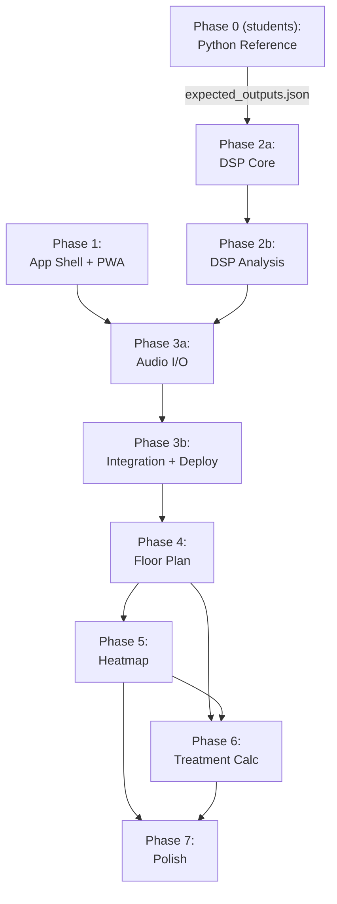

# EchoMap — Implementation Plan

> **Status:** Approved 2026-10-16. Phase 0 reinstated (re-assigned to assistant, split into Phase 0a and 0b).
> No code will be written until "go" is given for each phase.

---

## Environment

| Item | Value |
|---|---|
| App name | **EchoMap** (manifest `short_name` and UI title), subtitle "Room acoustic analyzer" |
| Test phones | Android (Chrome) |
| Second device | Phone or Bluetooth speaker as fixed sound source |
| Node.js | v22.23.1 (`node:test` supported) |
| Python | 3.14.8, NumPy 2.4.6, SciPy 1.16.2, Matplotlib 3.10.8 |
| Repo | github.com/Shail5320/room-acoustic-analyzer |
| Hosting | GitHub Pages, deploy from **main branch, root** |
| App URL | `https://shail5320.github.io/room-acoustic-analyzer/` |
| Phone testing | GitHub Pages URL + Chrome USB port forwarding |

---

## Design Decisions

| Decision | Detail |
|---|---|
| **Phase 0** | Reinstated (assistant-owned). Python reference scripts in `reference/`. Split into Phase 0a and 0b. `reference/expected_outputs.json` produced in Phase 0b serves as ground truth for Phase 2. |
| **Coordinates** | Floor plan uses relative (0–1) coords with a user-adjustable aspect ratio (default 4:3, stored in session). |
| **Heatmap distances** | IDW uses aspect-corrected distances: `d = sqrt((dx·R)² + dy²)` where R = width/height aspect ratio. |
| **Primary output** | Dimensionless absorption ratio per band: `RT60_measured / RT60_target`. |
| **Optional dimensions** | Metres or step count (~0.7 m/step, editable). Enables approximate m² material estimate. |
| **Sweep** | f1 = 50 Hz, f2 = 8000 Hz, T = 5 s. All config constants. Revisit f2 if 8 kHz band enabled. |
| **FFT** | Own radix-2 Cooley–Tukey, Float64Array. Benchmark at N = 2²⁰ on phone before considering a library. If a library is proposed, verify exact name, author, licence, and version — never cite from memory. |
| **Inverse filter** | Precompute its FFT spectrum once; reuse for all deconvolutions. |
| **Band filters** | 4th-order Butterworth bandpass (see specification below). Cascade of SOS, Float64. Validated against SciPy to ~0.01 dB. |
| **Noise floor** | Simplified truncation (not Lundeby unless faithfully implemented). Use pre-sweep silence to estimate noise. Test bias with synthetic IR + noise at known SNR. |
| **DSP threading** | Heavy DSP runs in a Web Worker. |
| **Two-device flow** | Measuring phone starts recording first → user taps Play on source device. Record window = T + 2–3 s tail + ~5 s slack. After deconvolution, validate that the peak stands clearly above the noise; reject with a clear message if not. |
| **Single-device** | Built after two-device. Labelled "less representative". Also serves as solo test mode. |
| **Wake Lock** | Feature-detect `navigator.wakeLock`. Verified support: Chrome Android 84+, Firefox Android 126+, Samsung Internet 14+ (MDN/caniuse, checked 2026-10-16). |
| **Relative paths** | Because the app is served under a repo subpath (`/room-acoustic-analyzer/`), manifest `start_url`/`scope`, service worker scope, and every asset path must be **relative** (e.g. `"./"`). |
| **Source fields** | `materials.json` and `targets.json`: every `source` field must be a verified reference (exact title, edition) or explicitly `"rule of thumb"` / `"placeholder"`. Never `"likely"`. |

---

## 4th-Order Butterworth Bandpass — Exact Specification

"4th-order Butterworth bandpass" means the **total filter order is 4** (2 poles from the highpass half, 2 from the lowpass half, each rolling off at 12 dB/octave).

| Property | Value |
|---|---|
| SciPy call | `scipy.signal.butter(N=2, Wn=[low, high], btype='bandpass', fs=sr, output='sos')` |
| Design order N | 2 |
| Resulting bandpass order | 2 × N = 4 |
| Number of SOS sections | 2 |
| Each SOS | Biquad with 6 coefficients `[b0, b1, b2, 1, a1, a2]` |
| Rolloff | 12 dB/octave (40 dB/decade) per side |

The JS implementation must use the same design (bilinear transform with pre-warping, N=2, output as 2 SOS) and produce coefficients matching SciPy to ≤ 1e-8 relative error. Magnitude responses must match to ~0.01 dB across the passband and transition bands.

Why N=2 and not N=4: a steeper filter (N=4 → 8th-order bandpass) has more ringing, which biases RT60 at low frequencies. N=2 is standard for octave-band analysis in room acoustics.

---

## Phase Sequence

Each phase (and sub-phase) ends with **STOP**. Do not proceed until "go" is given.

```
Phase 0a             →  Sweep, inverse filter, synthetic IRs, deconvolution
Phase 0b             →  Octave filters, Schroeder RT60, noise tests, expected_outputs.json
Phase 1              →  App shell + PWA deployed [COMPLETED]
Phase 2a             →  DSP core: FFT, sweep, deconvolution, filters
Phase 2b             →  DSP analysis: Schroeder, RT60, noise floor, Sabine
Phase 3a             →  Audio I/O + measurement flow
Phase 3b             →  Web Worker, single-device, results, deploy + phone test
Phase 4              →  Floor plan + data capture
Phase 5              →  Heatmap
Phase 6              →  Treatment calculator
Phase 7              →  Polish + hardening
```

---

## Phase 0a — Python Reference: Sweep, Synthetic IR, Deconvolution

**Goal:** Reference implementation of exponential sweep, inverse filter, synthetic IR generation, and deconvolution in pure NumPy/SciPy.

| # | Task | Acceptance |
|---|---|---|
| 0a.1 | `reference/requirements.txt` — pinned to actual installed versions (`numpy==2.4.6`, `scipy==1.16.2`, `matplotlib==3.10.8`) | File pinned to installed versions |
| 0a.2 | `reference/sweep.py` — Exponential sine sweep with f1=50 Hz, f2=8000 Hz, T=5 s, fs=48000 Hz (constants), 20 ms half-Hann fades. Inverse filter `x_inv(t) = x(T-t) * exp(-t/L)`. Plot spectrogram and magnitude spectrum in `reference/plots/` (sweep falls ~3 dB/oct, inverse rises ~3 dB/oct). | Spectrogram and spectrum plots generated |
| 0a.3 | Verify sweep convolved with inverse via `scipy.signal.fftconvolve` gives a sharp peak. Measure and report actual peak-to-sidelobe ratio in dB. Explain what limits it. | Peak-to-sidelobe reported in dB, explanation provided |
| 0a.4 | `reference/synthetic_ir.py` — Fixed RNG seed (`seed=42`). Generate two synthetic IRs: (a) Single RT60 = 0.8 s: `h(t) = n(t) * exp(-6.908 * t / RT60)`; (b) Multi-RT60 per octave band (125, 250, 500, 1k, 2k, 4k Hz = 1.2, 1.0, 0.8, 0.7, 0.6, 0.5 s) by summing band-limited noise decays. Save both as float64 fixtures in `reference/fixtures/`. | Both IRs saved as float64 raw/npy fixtures |
| 0a.5 | Create fake recording `y = fftconvolve(sweep, h)`. | Fake recording computed |
| 0a.6 | `reference/deconvolve.py` — `h_est = ifft(fft(y) * fft(x_inv))` with zero-padding to power-of-two $\ge \text{len}(y) + \text{len}(x_\text{inv}) - 1$. Peak detection, extract IR starting a few ms before peak, normalise. Compare with true synthetic IR (overlay plot + max error figure in `reference/plots/`). | Overlay plot and error metric generated |

**STOP after Phase 0a.**

---

## Phase 0b — Python Reference: Filters, Schroeder, RT60, Reference Outputs

**Goal:** Butterworth octave filtering, Schroeder decay curve, T20/T30 extraction, noise-floor bias tests, and generation of `reference/expected_outputs.json`.

| # | Task | Acceptance |
|---|---|---|
| 0b.1 | `reference/bands.py` — 4th-order Butterworth bandpass (N=2, 2 SOS) per octave band (125, 250, 500, 1000, 2000, 4000 Hz). Export SOS coefficients and frequency response. | Filter plots in `reference/plots/` |
| 0b.2 | `reference/rt60.py` — Schroeder integration, linear fit for T20 and T30, EDT, and R². | Decay curves plotted |
| 0b.3 | End-to-end recovery test on single-RT60 IR: verify recovered RT60 within ~5% of 0.8 s. | Error table printed |
| 0b.4 | End-to-end recovery test on multi-RT60 IR: verify per-band RT60 recovery. | Error table printed |
| 0b.5 | Noise-floor bias test: add white noise at 30 dB and 20 dB SNR, test with and without truncation. | Bias comparison table printed |
| 0b.6 | Produce `reference/expected_outputs.json` for Phase 2 validation. | File exists with ground truth numbers |
| 0b.7 | Write `docs/learning/phase0.md`. | Full learning note |

**STOP after Phase 0b.**

## Phase 1 — App Shell + PWA

**Goal:** Installable, offline-capable app shell deployed to GitHub Pages.

| # | Task | Acceptance |
|---|---|---|
| 1.1 | `index.html` — semantic HTML, `<meta viewport>`, relative links to manifest and CSS | Valid HTML, renders on phone |
| 1.2 | `style.css` — mobile-first single column, large tap targets (≥48 px), `prefers-color-scheme` for light/dark mode | Looks good on 360 px-wide screen |
| 1.3 | `manifest.webmanifest` — `name: "EchoMap"`, `short_name: "EchoMap"`, `start_url: "./"`, `scope: "./"`, `display: "standalone"`, theme colour, relative icon paths | Chrome "Add to Home Screen" works |
| 1.4 | `icons/` — 192 px and 512 px PNG placeholders (waveform or speaker glyph) | Referenced in manifest, installable |
| 1.5 | `sw.js` — versioned cache name (e.g. `echomap-v1`), cache app shell on install, serve cache-first. All cached URLs must be relative. | Offline load works after first visit |
| 1.6 | Register service worker in `index.html` with relative path. Handle registration errors. | Console: "SW registered" |
| 1.7 | Push to `main`, enable GitHub Pages (main branch, root) | Site loads at the app URL |
| 1.8 | Install on Android phone. Test in browser tab AND home-screen standalone mode. Test offline. Document any differences. | Installs, opens full-screen, works offline |
| 1.9 | Write `docs/learning/phase1.md` | PWA concepts, manifest, SW lifecycle, stale-cache pitfall, versioned cache strategy, relative paths under a subpath, 3 check questions |

**STOP after Phase 1.**

---

## Phase 2a — DSP Core: FFT, Sweep, Deconvolution, Filters

**Precondition:** `reference/expected_outputs.json` exists.

**Goal:** Core DSP modules in `src/dsp/`, tested against Python reference with `node --test`.

| # | Task | Acceptance |
|---|---|---|
| 2.1 | `src/dsp/fft.js` — Radix-2 Cooley–Tukey FFT and IFFT, Float64Array. Document whether interleaved or split real/imag. | Matches known DFT of impulse and sine |
| 2.2 | FFT round-trip test: `IFFT(FFT(x)) ≈ x`, max sample error < 1e-10 | Test passes |
| 2.3 | Benchmark FFT at N = 2²⁰ in Node; record wall-clock time | Time printed |
| 2.4 | `src/dsp/sweep.js` — Exponential sweep (f1, f2, T, sampleRate). Fade-in/out (e.g. 20 ms half-Hann). | Compare first/last 100 samples with Python reference by max difference |
| 2.5 | Inverse filter in `sweep.js` — time-reverse + exponential envelope. Precompute FFT of zero-padded inverse filter and export the spectrum for reuse. | Spectrum matches Python |
| 2.6 | Sweep ⊛ inverse test: report the **actual** peak-to-sidelobe ratio in dB (do not force a threshold). Compare full convolution waveform with Python by **max sample difference**. | Ratio reported; max difference printed |
| 2.7 | `src/dsp/deconvolve.js` — `IFFT(FFT(y) · InvSpectrum)`, zero-pad to power-of-two ≥ len(y)+len(inv)−1. Peak detection + IR extraction (start a few ms before peak). Normalise by peak. **Validate peak stands above noise** — compute peak-to-RMS of the pre-peak region and reject if too low. | Recovered IR from synthetic recording matches Python by max waveform difference |
| 2.8 | `src/dsp/bands.js` — Butterworth bandpass design: bilinear transform with pre-warping, N=2 design order, output as 2 SOS per band. Centres 125–4000 Hz. SOS filtering in Float64. | Coefficients match `scipy.signal.butter(N=2, ..., output='sos')` to ≤ 1e-8 relative error |
| 2.9 | Validate filter magnitude responses against SciPy at 200+ log-spaced frequencies per band | Max deviation **≤ ~0.01 dB** across passband and transition bands |

**STOP after Phase 2a.**

---

## Phase 2b — DSP Analysis: Schroeder, RT60, Noise Floor, Sabine

**Goal:** Complete analysis pipeline, end-to-end tested against Python reference.

| # | Task | Acceptance |
|---|---|---|
| 2.10 | `src/dsp/rt60.js` — Schroeder integration (reverse cumulative sum of h²), EDC in dB, least-squares fit for T20 (−5 to −25 dB), T30 (−5 to −35 dB), EDT (0 to −10 dB), R². Validity rules: T30 needs ≥ 35 dB range, T20 needs ≥ 25 dB, else invalid. | T20/T30 from clean synthetic IR within ~5% of true RT60 |
| 2.11 | Noise-floor estimation in `rt60.js` — accept pre-sweep silence samples (or estimate from IR tail). Truncate IR where smoothed squared envelope reaches noise floor. Compensate for truncated noise energy. Label as "simplified noise-floor truncation". | Unit test with known noise level |
| 2.12 | End-to-end test (single RT60): generate sweep → synthetic IR (RT60 = 0.8 s, same across bands) → convolve → deconvolve → band-filter → Schroeder → RT60. Compare with `expected_outputs.json`. | All bands within ~5% |
| 2.13 | End-to-end test (multi RT60): synthetic IR with **different RT60 per octave band** (e.g. 125 Hz → 1.2 s, 250 Hz → 1.0 s, 500 Hz → 0.8 s, 1 kHz → 0.6 s, 2 kHz → 0.5 s, 4 kHz → 0.4 s). Compare recovered per-band RT60 with true values and with Python. | Each band within ~5–10% (wider tolerance at 125 Hz due to filter ringing) |
| 2.14 | Noise-floor test: synthetic IR + white noise at 30 dB SNR and 20 dB SNR. Verify truncation reduces RT60 bias. Compare with Python noise-floor test. | Bias reduction documented, matches Python trend |
| 2.15 | `src/dsp/sabine.js` — (a) Dimensionless absorption ratio: `RT60_measured / RT60_target` per band. (b) Optional (when V provided): Sabine A = 0.161·V/RT60, Delta_A, S_panel. (c) Eyring cross-check (requires dimensions). | Unit tests with hand-calculated values |
| 2.16 | All tests green: `node --test tests/` | Zero failures |
| 2.17 | Write `docs/learning/phase2.md` | FFT (radix-2 butterfly), sweep math, deconvolution, Butterworth (bilinear transform, pre-warping, SOS stability, why N=2), Schroeder method, noise floor, Sabine/Eyring, formulas, code map, common mistakes, 3 check questions |

**STOP after Phase 2b.**

---

## Phase 3a — Audio I/O + Measurement Flow

**Goal:** Capture audio on a real phone with processing disabled, play sweeps, implement the two-device measurement flow.

| # | Task | Acceptance |
|---|---|---|
| 3.1 | `src/audio/mic.js` — `getUserMedia({ audio: { echoCancellation: false, noiseSuppression: false, autoGainControl: false, channelCount: 1 } })`. Read back `getSettings()`, warn in UI if any processing is still on. | Settings logged, warning shown if active |
| 3.2 | `src/audio/recorder-worklet.js` — `AudioWorkletProcessor`, pushes Float32 chunks via `port.postMessage` | Raw samples arrive in main thread |
| 3.3 | `src/audio/player.js` — `AudioBuffer` from sweep Float64Array, play via `AudioBufferSourceNode`. Use actual `AudioContext.sampleRate`. | Sweep audible on phone speaker |
| 3.4 | Source mode screen — "Play Sweep" button with countdown/progress bar | Works on second device |
| 3.5 | Measure mode screen — Two-device flow: tap "Start" begins recording. Record window = **T + 3 s tail + 5 s slack = 13 s** (configurable). User taps Play on source device during the slack period. After recording completes, run deconvolution. **Validate peak**: compute peak-to-RMS of pre-peak noise region; reject with clear message ("No sweep detected — make sure the source played during recording") if peak is not clearly above noise. | Full pipeline runs, rejection works |
| 3.6 | `AudioContext.resume()` on user tap. Test in both browser tab and home-screen standalone mode on Android Chrome. | No silent-context bugs |
| 3.7 | Pre-measurement: record ~2 s silence, compute RMS, estimate noise floor in dBFS, warn if too high (initial threshold: −30 dBFS, adjust after real testing) | Warning appears in noisy environment |
| 3.8 | Post-measurement: scan for clipping (|sample| > 0.99), warn or reject | Clipping warning shown |
| 3.9 | Live level meter (RMS of recent chunks, displayed as bar) | Meter animates during recording |
| 3.10 | Screen Wake Lock: feature-detect `navigator.wakeLock`, acquire during measurement, release after. Handle errors. | Screen stays on during 13+ s measurement |

**STOP after Phase 3a.**

---

## Phase 3b — Web Worker, Single-Device, Results, Deploy

**Goal:** DSP off the main thread, single-device fallback, results display, real phone test.

| # | Task | Acceptance |
|---|---|---|
| 3.11 | Web Worker: move deconvolution, band filtering, RT60 computation off main thread. Precompute sweep and inverse filter spectrum on app load. | UI stays responsive during processing |
| 3.12 | Single-device fallback: same phone plays and records simultaneously. UI clearly labelled "Single-device mode — source moves with phone, results are less representative of room variation." | Mode selectable, results labelled |
| 3.13 | Results screen: IR waveform plot, EDC curves per band (dB), RT60 table per band with T20/T30/EDT, R², validity flags, which estimate was used | Plots render on phone |
| 3.14 | Deploy to GitHub Pages, test on real Android phone. Test in browser tab AND standalone mode. Document: what works, what doesn't, processing flags status, any differences. | Honest written test report |
| 3.15 | Write `docs/learning/phase3.md` | Web Audio API, AudioContext, AudioWorklet, getUserMedia constraints, why disable processing, Wake Lock, Web Workers, two-device vs single-device, 3 check questions |

**STOP after Phase 3b.**

---

## Phase 4 — Floor Plan + Data Capture

**Goal:** Interactive floor plan with aspect ratio, measurement positions, save/load, export.

| # | Task | Acceptance |
|---|---|---|
| 4.1 | `src/ui/floorplan.js` — Canvas rendering of a rectangular room. Relative coordinates (0–1). User-adjustable **aspect ratio** (default 4:3), stored in session. Canvas drawing respects aspect ratio. | Room draws correctly at various ratios |
| 4.2 | Tap to place source position (distinct marker). One source per session, movable. | Source marker visible and repositionable |
| 4.3 | Tap to place measurement positions (numbered markers). Each linked to its measurement data. | Markers numbered sequentially |
| 4.4 | Pixel ↔ relative coordinate transform. Unit test: known pixel → known relative coord, and back, for several aspect ratios. | Tests pass for 4:3, 16:9, 1:1 |
| 4.5 | Measurement list: scrollable list of points with summary (position, RT60 at selected band, validity) | List updates after each measurement |
| 4.6 | Optional room dimensions: toggle panel, enter L × W × H in metres OR step count (editable ~0.7 m/step). Stored in session, not required. | Saves/loads. Omitting doesn't break anything. |
| 4.7 | `src/store/storage.js` — IndexedDB. Session = { id, name, created, aspectRatio, roomDimensions?, source?, measurements[] } | Save, close, reopen, load — data intact |
| 4.8 | Export to JSON (full data) and CSV (one row per measurement × band). Positions in relative coords; include metric coords if dimensions provided. | Files download, readable |
| 4.9 | Write `docs/learning/phase4.md` | Canvas coordinates, IndexedDB, relative vs absolute coords, aspect ratio, 3 check questions |

**STOP after Phase 4.**

---

## Phase 5 — Heatmap

**Goal:** RT60 heatmap over the floor plan in aspect-corrected relative space.

| # | Task | Acceptance |
|---|---|---|
| 5.1 | `src/ui/heatmap.js` — IDW interpolation (power p = 2) on a grid over (0–1) × (0–1). Distances are **aspect-corrected**: `d = sqrt((dx·R)² + dy²)` where R = aspect ratio (width/height). | Interpolation exact at measurement points |
| 5.2 | Colour scale: perceptual ramp (blue = low RT60, red = high). Legend with tick marks and unit (seconds). | Colours distinguishable, legend renders |
| 5.3 | Band selector: buttons or dropdown for 125–4000 Hz. Re-renders heatmap on change. | Heatmap updates per band |
| 5.4 | Overlay: source marker (distinct) + numbered measurement points on top of heatmap | Markers visible over colours |
| 5.5 | If < 4 valid points: "Not enough data for a reliable heatmap. We recommend at least 9 measurement points spread across the room." Heatmap hidden or shown with strong caveat. | Message shown |
| 5.6 | Node test: synthetic data (5 points, known values), verify exact reproduction at measured points and reasonable interpolation between. Test with different aspect ratios. | Tests pass |
| 5.7 | Visual test on phone: smooth gradients, no edge artifacts | Screenshot in report |
| 5.8 | Write `docs/learning/phase5.md` | IDW formula, why power=2, aspect-corrected distance, limitations with few points, colour mapping, 3 check questions |

**STOP after Phase 5.**

---

## Phase 6 — Treatment Calculator

**Goal:** Dimensionless ratio always; m² of material only with dimensions.

| # | Task | Acceptance |
|---|---|---|
| 6.1 | Target RT60 input: manual entry or preset from `targets.json` | Presets load, manual works |
| 6.2 | **Primary result (no dimensions needed):** per-band absorption ratio bar chart. `ratio = RT60_measured / RT60_target`. Ratio > 1 → more absorption needed. Ratio ≤ 1 → target met. | Chart renders, values correct |
| 6.3 | **Optional result (dimensions provided):** Delta_A per band, S_panel for a selected material. Sabine and Eyring side-by-side when avg alpha > ~0.3. Step-count results labelled "approximate". | Numbers match hand calculation |
| 6.4 | `src/data/materials.json` — Placeholder entries with `"placeholder": true`. Each has name, alpha per band, `source: "placeholder — verify with manufacturer datasheet"`. | Valid JSON, UI shows warning |
| 6.5 | `src/data/targets.json` — Presets. Each `source` field is a verified reference (exact title and edition) or `"rule of thumb"`. **Never `"likely"`**. | Valid JSON, sources honest |
| 6.6 | `alpha_existing_surface` input: editable, default 0.05 (painted concrete). | Input works, updates calculation |
| 6.7 | Placement hint: heatmap highlights regions with longest RT60 (top quartile). Caption: "These areas have the longest reverberation. Consider treating nearby walls/ceiling. This is a heuristic, not a calculated placement." | Highlight visible, disclaimer shown |
| 6.8 | Limitations text: Sabine diffuse-field assumption, small-room/low-freq caveat, step-count error propagation. | Text visible |
| 6.9 | Write `docs/learning/phase6.md` — includes hand-checked example both with and without dimensions | Two worked examples, 3 check questions |

**STOP after Phase 6.**

---

## Phase 7 — Polish and Hardening

**Goal:** Production quality, error handling, accessibility, documentation.

| # | Task | Acceptance |
|---|---|---|
| 7.1 | UI cleanup: consistent spacing, transitions, loading states | Polished on phone |
| 7.2 | Error states: mic denied, no secure context, unsupported browser (AudioWorklet, getUserMedia) | Each shows helpful message |
| 7.3 | Accessibility: labels, WCAG AA contrast, focus outlines, TalkBack navigable | Manual check |
| 7.4 | In-app help cards: RT60, absorption vs insulation, echo cancellation, heatmap, absorption ratio | Accessible from each screen |
| 7.5 | Test browser tab vs standalone on Android Chrome. Document differences. | Report written |
| 7.6 | `README.md` — overview, setup, deployment, tests (`node --test tests/`), Python reference, known limitations | Complete and accurate |
| 7.7 | Known limitations: Sabine limits, phone speaker/mic freq limits, 125 Hz marginal, single-device caveats, few-point heatmap, placeholder materials | Section complete |
| 7.8 | Write `docs/learning/phase7.md` | Error handling, a11y, deployment, 3 check questions |

**STOP after Phase 7. Project complete.**

---

## Consequences of Dimension-Optional Design

1. **Eyring cross-check** only available when dimensions are entered.
2. **Step-count error propagation:** V = L × W × H; ~10% per dimension → ~30% volume error. Material area inherits this. UI must state it.
3. **No physical scale bar** on floor plan or heatmap without dimensions. Axes show relative 0–1.
4. **Export** uses relative coords (0–1) by default. Metric columns added when dimensions provided.
5. **Source-to-mic distance** unknown in physical units without dimensions. Doesn't affect RT60 (depends on IR shape only).
6. **Sabine A = 0.161·V/RT60** is gated behind dimensions. Dimensionless ratio path has zero dependency on dimensions.

---

## Material & Target Sources

### materials.json

Every entry ships as `"placeholder": true` until verified. Datasheets/tables to investigate:

- Manufacturer test data (ISO 354): Owens Corning 703/705, Rockwool, Auralex
- Textbook tables: *Acoustic Absorbers and Diffusers*, Trevor Cox & Peter D'Antonio, 3rd ed., 2017
- Textbook tables: *Master Handbook of Acoustics*, F. Alton Everest & Ken Pohlmann, 6th ed., 2015

### targets.json

| Preset | Typical value | Source |
|---|---|---|
| Small control room | 0.3–0.4 s | To be verified — check EBU Tech 3276, or mark "rule of thumb" |
| Vocal booth | 0.2–0.3 s | Rule of thumb |
| Live room / tracking | 0.6–1.0 s | Rule of thumb |
| Podcast / voiceover | 0.2–0.4 s | Rule of thumb |

Every source field must be a verified citation (exact title, edition, section) or `"rule of thumb"`. Never `"likely"`.

---

## Dependency Graph


