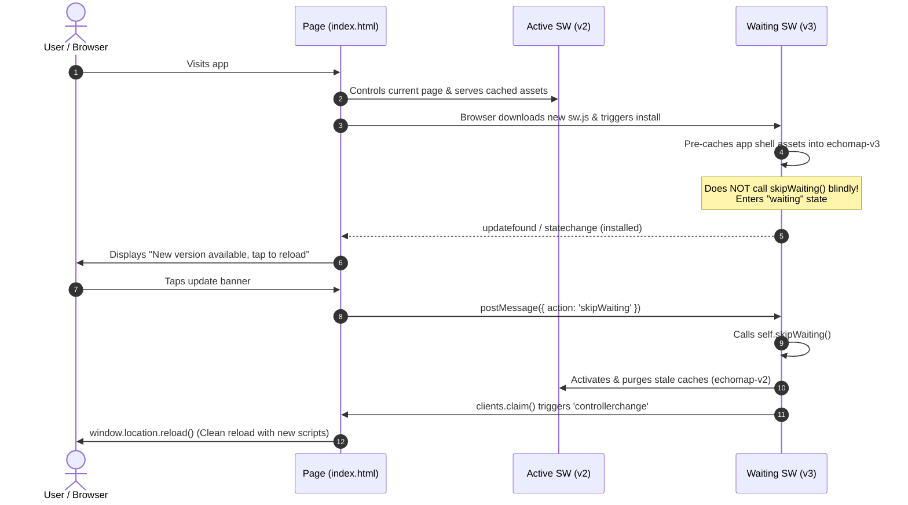

# Phase 1: App Shell & Progressive Web App (PWA)

## 1. Concepts in Plain Language

A **Progressive Web App (PWA)** is a standard website built with HTML, CSS, and JavaScript that behaves like a native mobile application when installed on a phone or tablet.

### How Does a Web Page Become an "App"?
A regular website requires an active internet connection and only runs inside a browser tab. To become an installable app, two key components are needed:
1. **The Web App Manifest (`manifest.webmanifest`):** A JSON metadata file that tells the operating system (e.g. Android) how to present the app. It defines the app name, icons, theme colors, and the `display: "standalone"` property, which removes the browser's URL address bar and navigation buttons so it feels like a native app.
2. **The Service Worker (`sw.js`):** A special background script that the browser runs independently of the web page. It acts as an in-browser programmable network proxy. Every time the page requests a file (HTML, CSS, image), the request first passes through the service worker. The service worker can intercept the request and respond immediately from an offline cache (`caches.match`), even if the device has no internet access or is in airplane mode.

### The App Shell Architecture
In an **App Shell** architecture, we separate the static user interface framework (header, navigation, container styling, icons) from dynamic content. By pre-caching this "shell", the app loads instantly on repeat visits regardless of network speed.

---

## 2. Technical Specifications & Formulas

### Relative Paths Under Subpath Hosting
When an app is hosted at the root domain (e.g., `https://example.com/`), absolute paths like `/index.html` or `/sw.js` work fine. However, GitHub Pages hosts project sites under a repository subpath:
$$\text{URL} = \text{https://<username>.github.io/<repo-name>/}$$

If an app at `https://shail5320.github.io/room-acoustic-analyzer/` references `/style.css`, the browser attempts to fetch `https://shail5320.github.io/style.css` (404 Not Found), completely missing the repository folder.

**Specification:** All URLs in `index.html`, `manifest.webmanifest`, and `sw.js` must be strictly relative:
- Manifest link: `./manifest.webmanifest`
- Stylesheet: `./style.css`
- Manifest start URL & scope: `"start_url": "./"`, `"scope": "./"`
- Pre-cache list in `sw.js`: `'./'`, `'./index.html'`, `'./style.css'`, etc.

### Service Worker Lifecycle & Safe Update Flow
The service worker lifecycle follows structured, asynchronous phases:

1. **Registration:** The web page registers `./sw.js` with scope `./`.
2. **Installation (`install` event):** The browser downloads the new service worker. We open a versioned cache (e.g. `echomap-v3`) and pre-cache core assets via `cache.addAll()`.
   > [!IMPORTANT]
   > **Do not call `self.skipWaiting()` automatically during install.** Calling `skipWaiting()` blindly forces the new worker to take control while the user is actively interacting with the old page. This can cause **version skew**—where in-memory old JavaScript attempts to dynamically fetch new modules or endpoints with incompatible interfaces, breaking application state.
3. **Waiting State & User Notification:** The new service worker enters the `installed` / `waiting` state (`registration.waiting`). The client page detects the waiting worker (either on registration or via `updatefound` / `statechange`) and surfaces a persistent banner: *"New version available, tap to reload"*.
4. **User-Triggered SkipWaiting:** When the user taps the banner, the client posts `{ action: 'skipWaiting' }` to the waiting worker. The service worker listens for the `message` event and calls `self.skipWaiting()`.
5. **Activation (`activate` event):** The new worker activates. It iterates over all cache keys using `caches.keys()` and deletes any cache whose name does not match `CACHE_NAME` (e.g. deleting `echomap-v2`). It then calls `self.clients.claim()` to take control of all active clients.
6. **Coordinated Client Reload (`controllerchange`):** The web page listens to `navigator.serviceWorker.addEventListener('controllerchange', ...)` and invokes `window.location.reload()`. This ensures the page and its scripts are fully refreshed in lockstep with the newly activated cache.

---

### Hybrid Caching Strategy: Network-First vs. Cache-First

Different types of assets require distinct caching behaviors to balance freshness against offline reliability:

| Request Category | Target Assets | Strategy | Rationale |
|---|---|---|---|
| **Navigation / Document** | `index.html`, `/`, `./` | **Network-First** (fallback to Cache) | Online users immediately fetch the latest HTML shell and detect app updates. If offline, the cached shell loads seamlessly. |
| **Static Sub-Resources** | `style.css`, `*.js`, `*.png`, `manifest` | **Cache-First** (fallback to Network) | Versioned static assets are immutable for a given release. Cache-first guarantees instant load performance and minimal bandwidth. |

#### Mathematical / Logical Formulation

For navigation requests (`request.mode === 'navigate'` or URL ending in `/` or `index.html`):
$$\text{Response}_{\text{HTML}} = \text{Network}(\text{Request}) \;\operatorname{catch}\; \Big(\text{Cache}(\text{Request}) \;\lor\; \text{Cache}(\text{'./index.html'})\Big)$$

For static asset requests (CSS, JS, images, manifest):
$$\text{Response}_{\text{Asset}} = \text{Cache}(\text{Request}) \;\operatorname{catch}\; \Big(\text{Network}(\text{Request}) \;\to\; \text{CachePut}(\text{Request})\Big)$$

---

## 3. Code Implementation Map

| Component / Function | File | Purpose |
|---|---|---|
| Semantic markup, SW loader & update banner | [`index.html`](../../index.html) | Defines app shell structure, version badge in status panel (`#status-version`), `#update-banner`, and registration logic with `controllerchange` reload handler. |
| Light/Dark mobile layout & Banner styles | [`style.css`](../../style.css) | Single-column design, `prefers-color-scheme` CSS variables, touch targets $\ge 48\text{ px}$, and fixed update banner (`.update-banner`). |
| PWA metadata & display mode | [`manifest.webmanifest`](../../manifest.webmanifest) | Declares app name `EchoMap`, standalone display mode, orientation, theme colors, and icons. |
| App icons | [`icons/icon-192.png`](../../icons/icon-192.png), [`icons/icon-512.png`](../../icons/icon-512.png) | 192×192 and 512×512 PNG icons required for Android home screen and splash screens. |
| Versioned pre-caching, message listener & hybrid fetch | [`sw.js`](../../sw.js) | Handles `install` (pre-caching without blind skipWaiting), `message` (`skipWaiting` on demand), `activate` (cache eviction), and hybrid fetch proxying (network-first for HTML, cache-first for assets). |

---

## 4. Common Beginner Mistakes

1. **The Blind `skipWaiting()` Hazard (Script & State Skew):**
   Calling `self.skipWaiting()` directly in the `install` event forces an immediate swap of the controlling service worker. If the user has an open tab, lazy-loaded JavaScript chunks, newly structured HTML, or changed DSP calculation pipelines will be fetched under the new version while the in-memory tab runs old logic. This leads to broken UI state and mysterious `TypeError` crashes. Always prompt the user and synchronize reloads via `controllerchange`.
2. **The Cache-First `index.html` Trap:**
   If `index.html` is served Cache-First, the browser never reaches the network to see that a new `index.html` exists pointing to updated scripts. Serving `index.html` **Network-First** ensures the user receives updates as soon as they are online while maintaining robust offline fallback.
3. **The Stale-Cache Orphan Trap:**
   Failing to iterate through `caches.keys()` and purge old cache names (e.g. `cacheName !== CACHE_NAME`) during `activate` consumes device storage indefinitely and can serve stale cached files if URLs overlap.
4. **Absolute vs. Relative URLs in Pre-caching:**
   Writing `'/index.html'` instead of `'./index.html'` breaks on GitHub Pages or any subpath deployment.
5. **Missing HTTPS:**
   Service workers and device sensor APIs (like microphone access in future phases) strictly require a **Secure Context** (`https://` or `http://localhost`). Loading `http://<laptop-lan-ip>:8000` on a phone over Wi-Fi will block the service worker from registering.
6. **Touch Target Size (< 48 px):**
   Buttons smaller than 48×48 px lead to missed taps and accidental clicks on mobile devices. Always enforce `min-height: 48px; min-width: 48px;` for interactive elements.

---

## 5. Check Your Understanding

1. **Why does GitHub Pages require relative paths (`./`) in the Web App Manifest and Service Worker pre-cache list instead of root-relative paths (`/`)?**
   *Because GitHub Pages project sites are served under a subpath (`https://<user>.github.io/<repo>/`). Root-relative paths (`/`) resolve to the root domain (`https://<user>.github.io/`), missing the repository folder and causing 404 Not Found errors.*

2. **Why is calling `self.skipWaiting()` blindly in the `install` event considered an anti-pattern for apps with dynamic scripts?**
   *Blindly calling `skipWaiting()` activates the new service worker immediately while an old version of the page is still loaded in the user's browser. If the user triggers an action that requests additional assets or scripts, the new worker serves files matching the new build, which may have different hashes, removed exports, or modified DOM selectors, leading to runtime failures.*

3. **Why should `index.html` use a Network-First strategy while static assets (`style.css`, images) use Cache-First?**
   *`index.html` serves as the entry point that links all other assets. By checking the network first for `index.html`, the browser can immediately discover new releases whenever an internet connection is present. Static assets, which are tied to specific releases or hash-identified, can safely be served Cache-First for instant loading and zero network latency.*

4. **How does the page coordinate with the Service Worker to perform a clean reload without version mismatch?**
   *The page listens for the `controllerchange` event on `navigator.serviceWorker`. When the user taps the "New version available" banner, the page sends a message (`skipWaiting`) to the waiting worker. Once the worker activates and claims the client, the `controllerchange` event fires, and the page invokes `window.location.reload()`, ensuring both the DOM and all scripts refresh together.*

