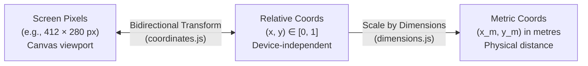
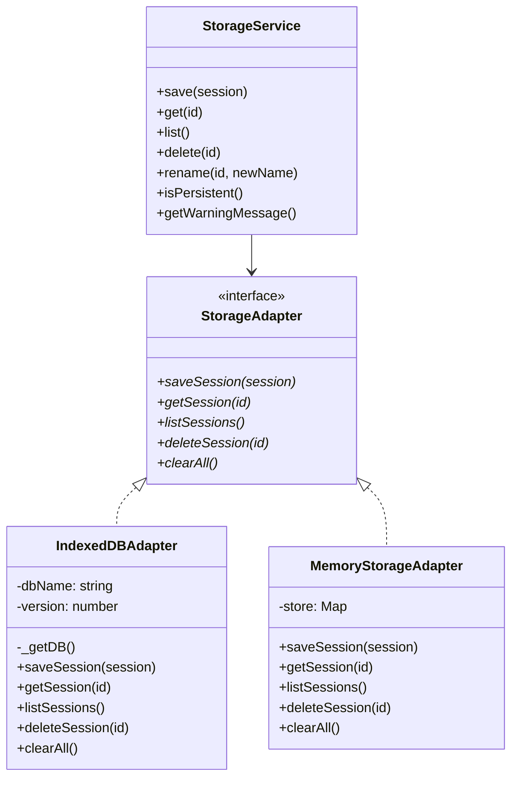

# Phase 4: Floor Plan, Room Dimensions, IndexedDB Storage & Export

## 1. Concepts in Plain Language

### Interactive Floor Plan & Canvas Coordinates
An interactive floor plan requires rendering a dynamic geometric room and visual markers on an HTML `<canvas>`. Two core challenges arise on mobile devices:
1. **High-DPI Displays (Retina / Mobile Screens):** Mobile screens pack multiple physical hardware pixels into each CSS display pixel (Device Pixel Ratio, or $\text{DPR} \ge 2$ or $3$). If a canvas buffer is sized only to its CSS pixel width, lines and marker text appear blurry. To render sharp graphics, the internal canvas pixel buffer is scaled by $\text{DPR}$ ($\text{width} = \text{cssWidth} \times \text{DPR}$), while the rendering context is scaled by $\text{ctx.scale(DPR, DPR)}$.
2. **Aspect Ratio Preservation (Letterboxing & Pillarboxing):** Rooms vary from square ($1:1$) to long corridors ($2:1$). When displaying a rectangular room inside an arbitrary screen area, the room must not distort. By computing a centered bounding box within the canvas, we letterbox (leave space top/bottom) or pillarbox (leave space left/right), keeping geometry faithful to the specified aspect ratio.

---

### Relative vs. Absolute vs. Metric Coordinates
An acoustics app must distinguish between three coordinate systems:

1. **Relative Coordinates $(x_{\text{rel}}, y_{\text{rel}}) \in [0, 1]$:**
   - $(0, 0)$ is the top-left corner of the room; $(1, 1)$ is the bottom-right corner.
   - Relative coordinates are completely independent of screen size, canvas zoom, and device orientation. A microphone positioned at $(0.5, 0.5)$ remains dead-center on a phone screen, a tablet, or an exported data file.
2. **Absolute Pixel Coordinates $(x_{\text{px}}, y_{\text{px}})$:**
   - Screen-space coordinates where the user's finger taps or drags. Pointer events deliver pixels, which are transformed into relative room coordinates. Taps outside the room boundary are ignored; dragging is clamped strictly to the room walls $[0, 1]$.
3. **Metric Coordinates $(x_m, y_m)$:**
   - Physical space coordinates in metres ($x_m = x_{\text{rel}} \cdot L_m$, $y_m = y_{\text{rel}} \cdot W_m$).
   - Metric coordinates exist **only if room dimensions are provided**. Omitting dimensions never invalidates relative coordinates or RT60 decay measurements.

---

### Room Dimensions: Metres vs. Step Counts
Entering room dimensions is optional. When users have a tape measure or laser measure, they enter direct metres ($L \times W \times H$). When measuring casually in a hall, they can enter step counts (paces) with an editable conversion factor (default $0.70\text{ m/step}$).
- **The "Approximate" Caveat:** Human paces vary by terrain and walking speed. A 10% pacing uncertainty propagates to a $\sim 30\%$ error in room volume ($V = L \times W \times H$). Therefore, any dimension or coordinate derived from step counts is visibly tagged **Approximate** in the UI and marked with a tilde prefix (`~`) in CSV exports.
- **Aspect Ratio Synchronization:** When room dimensions are entered, the floor plan aspect ratio is automatically derived from $L / W$. If the user subsequently edits the aspect ratio manually in the dropdown, the app explicitly asks or warns before decoupling the aspect ratio from the dimensions.

---

### Client-Side Persistence with IndexedDB
Web applications cannot use standard filesystem APIs on mobile devices.
- **Why Not `localStorage`?** `localStorage` is synchronous (blocking audio playback or UI rendering), limited to $\sim 5\text{ MB}$, and only stores serialized strings.
- **IndexedDB:** An asynchronous, transactional, structured NoSQL database built into all modern browsers. It stores raw JavaScript objects, uses versioned schemas (`IDBOpenDBRequest.onupgradeneeded`), and can store gigabytes of measurement curves and impulse responses.
- **Graceful Fallback:** If IndexedDB is blocked (e.g., Firefox private browsing mode, storage quota exceeded, or in Node.js test environments), the app catches the exception and falls back to an in-memory storage adapter, surfacing a visible note without crashing.

---

### The Adapter Pattern for Storage & Testing
Testing IndexedDB in a pure Node.js test runner (`node:test`) usually requires bloated polyfills (like `fake-indexeddb`). By applying the **Adapter Pattern**, we separate storage business logic from browser-specific database drivers:

- In production (browser), `StorageService` initializes `IndexedDBAdapter`.
- In automated unit tests (Node), `StorageService` is injected with `MemoryStorageAdapter`. Tests execute 100% in-memory with zero external dependencies.

---

### CSV Export & Escaping Pitfalls
CSV (Comma-Separated Values) appears simple, but naive string formatting (`row.join(',')`) frequently breaks in real-world use:
1. **Commas in Content:** A session name like `"Living Room, 2nd Floor"` produces an extra comma, shifting every subsequent column.
2. **Double Quotes:** Quotes in session names must be escaped by doubling them (`""`) and enclosing the field in quotes (`"Living ""Great"" Room"`).
3. **Newlines:** Multiline notes or names contain `\n` or `\r`, which must remain enclosed within the cell's quoted boundaries per **RFC 4180**.
4. **Empty Data Cells for Pending Points:** Unmeasured points must preserve table column alignment by outputting blank fields (`""`) rather than `NaN` or `undefined`.
5. **Simulated (DEV) Test Flag Preservation:** Exporting must never discard the `fake` column. If any measurement was synthetically generated, a visible alert warns the user before downloading.

---

## 2. Technical Specifications & Formulas

### Coordinate Transformations
Given canvas bounding box $[X_b, Y_b, W_b, H_b]$:
$$\text{To Pixels:} \quad x_{\text{px}} = X_b + x_{\text{rel}} \cdot W_b, \quad y_{\text{px}} = Y_b + y_{\text{rel}} \cdot H_b$$
$$\text{To Relative:} \quad x_{\text{rel}} = \frac{x_{\text{px}} - X_b}{W_b}, \quad y_{\text{rel}} = \frac{y_{\text{px}} - Y_b}{H_b}$$

Taps where $x_{\text{rel}} < 0$ or $x_{\text{rel}} > 1$ or $y_{\text{rel}} < 0$ or $y_{\text{rel}} > 1$ return `null`. Drag events clamp values:
$$x_{\text{rel, clamped}} = \max(0, \min(1, x_{\text{rel}}))$$

### Metric Conversion & Range Validation
$$\text{Metres Mode:} \quad L_m = L, \quad W_m = W, \quad H_m = H$$
$$\text{Steps Mode:} \quad L_m = L_{\text{steps}} \cdot S, \quad W_m = W_{\text{steps}} \cdot S, \quad H_m = H_{\text{steps}} \cdot S \quad (S = 0.70\text{ m/step})$$
$$\text{Validation Bounds:} \quad 1.0\text{ m} \le L_m, W_m \le 50.0\text{ m}, \quad 2.0\text{ m} \le H_m \le 10.0\text{ m}$$
$$\text{Derived Aspect Ratio:} \quad R = \frac{L_m}{W_m}$$

### CSV Column Specification (RFC 4180)
The CSV export flattens session measurements into one row per measurement per octave band ($125, 250, 500, 1000, 2000, 4000\text{ Hz}$):
- **Without Room Dimensions (17 columns):**
  `session,point_index,status,x_rel,y_rel,band_hz,t20,t30,edt,r2,used,tier,pnr_db,dynamic_range_db,clipped,fake,timestamp`
- **With Room Dimensions (19 columns):**
  `session,point_index,status,x_rel,y_rel,x_m,y_m,band_hz,t20,t30,edt,r2,used,tier,pnr_db,dynamic_range_db,clipped,fake,timestamp`

---

## 3. Code Implementation Map

| Module / Component | File | Responsibility |
|---|---|---|
| Coordinate Math & Bounding Box | [`src/ui/coordinates.js`](../../src/ui/coordinates.js) | Aspect ratio letterboxing, DPI scaling, and bidirectional $[0, 1] \leftrightarrow \text{pixel}$ transforms. |
| Dimensions Validation & Conversion | [`src/ui/dimensions.js`](../../src/ui/dimensions.js) | Pure unit conversions (metres vs. steps), bounds validation, aspect ratio derivation, and metric coordinate scaling. |
| Session & Measurement Model | [`src/ui/session-model.js`](../../src/ui/session-model.js) | State model for session metadata, movable source position, numbered points list, fake test data generator, and observer subscriptions. |
| Canvas Floor Plan View | [`src/ui/floorplan.js`](../../src/ui/floorplan.js) | High-DPI canvas rendering, grid, pointer interaction (tap to add, drag to move), and reactive redraws. |
| Storage Service & Adapters | [`src/store/storage.js`](../../src/store/storage.js) | `StorageService` managing session lifecycle (save, auto-save debounce, list, get, rename, delete) with `IndexedDBAdapter` and `MemoryStorageAdapter`. |
| Export Utilities | [`src/store/export.js`](../../src/store/export.js) | Pure `toJSON()` and `toCSV()` functions with RFC 4180 quoting, fake flag retention, and browser `Blob` download trigger. |
| UI Controller | [`src/ui/app.js`](../../src/ui/app.js) | Wires DOM controls, dimensions panel, session management modal, auto-save debouncer, and octave band selection. |

---

## 4. Common Mistakes & Edge Cases

1. **Hardcoding Screen Pixels in Data Files:** Storing pixel coordinates ($x=240, y=180$) binds measurement locations to a specific phone screen. Always store normalized $[0, 1]$ relative coordinates and convert to pixels only at render time.
2. **Silently Overriding Aspect Ratios:** If dimensions ($6\text{ m} \times 4\text{ m}$) derive a $1.5:1$ aspect ratio, allowing the user to select $16:9$ without warning creates a desynchronized state where metric coordinates no longer match the displayed room shape. The UI must warn and decouple before applying the manual ratio.
3. **Missing `onupgradeneeded` in IndexedDB:** Attempting to create an object store inside `onsuccess` throws an `InvalidStateError`. Object stores and indexes can only be defined inside the `onupgradeneeded` lifecycle hook.
4. **Naive CSV String Concatenation:** Writing `${name},${point}` breaks whenever a name contains commas or quotes. Every text field must pass through RFC 4180 quote escaping.

---

## 5. Check Questions

### Q1: Why must room positions be stored internally as relative coordinates $(0\text{--}1)$ rather than metric distances $(x_m, y_m)$ or canvas pixels?
**Answer:** Relative coordinates decouple spatial position from physical dimensions and screen display hardware. If coordinates were stored in pixels, rotating a mobile device or changing screen resolution would displace points. If stored directly in metres, acoustic measurements could not be taken until physical room dimensions were known and entered. By storing relative coordinates, the floor plan is fully functional immediately, and metric positions can be calculated dynamically whenever dimensions are supplied.

### Q2: What is the primary benefit of the Adapter Pattern when implementing client-side storage?
**Answer:** The Adapter Pattern decouples the high-level storage interface (`save`, `get`, `list`, `delete`) from the underlying storage mechanism (`IndexedDB` in browsers vs. `Map` in memory). This enables running automated tests in Node.js with a fast, zero-dependency `MemoryStorageAdapter`, while also providing an automatic fallback in browser private-browsing modes where IndexedDB is blocked.

### Q3: Under RFC 4180, how must a session name containing double quotes and a comma (e.g., `Studio "Live", Take 1`) be encoded in a CSV cell?
**Answer:** Any cell containing a comma, newline, or double quote must have internal double quotes doubled (`""`) and the entire string wrapped in enclosing double quotes:
`"Studio ""Live"", Take 1"`
